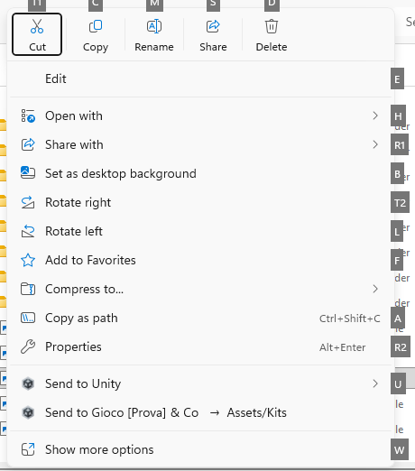
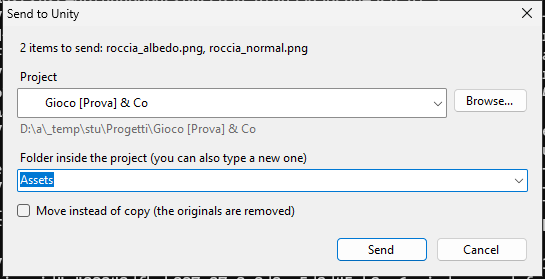
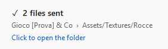
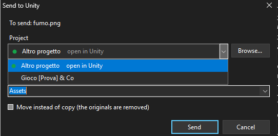
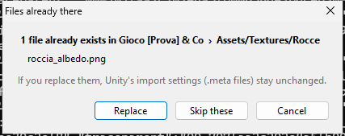

# Send to Unity

Send files and folders from File Explorer straight into a Unity project with a right-click:
no dragging, no side-by-side windows.

On Windows 11 the item is also in the short menu, the one that opens first:

## How to use it

Select the files (or a folder), right-click > **Send to Unity** > click the project.

- **The first time** you use a project a window opens: choose the folder inside `Assets`
  (you can also type a new one, it gets created).

  

- **From the second time on** the project shows up in the menu with its folder: one click and the
  files are in, no windows. Only a notification appears in the bottom-right corner; clicking it
  opens the folder with the file that just arrived already selected (it stays up while the mouse
  is over it). If the copy takes a while (big folders, heavy files) the notification shows the
  progress.

  

- The most recently used projects are at the top. They come from Unity Hub and from Unity's
  recent projects; if one is missing: **Choose project and folder...** > **Browse...**
  Two projects with the same name are told apart by the folder that contains them.
- If the project is **open in Unity**, once the copy is done Unity is brought to the front and
  imports the files right away. If it's closed, it imports them the next time it opens. Open
  projects have a green dot, both in the menu and in the window: the menu is built every time
  you open it, so the dot is always up to date.

  
- If a file **already exists** you can replace it or skip it. When replacing, the `.meta` file
  stays: references and import settings in Unity don't break. Pressing Enter replaces.
  If Unity is still importing the old file, the program waits a few seconds and tries again.

  

- It works with many files at once (tested with 40) and with folders, subfolders included.
  When copying a folder, `.git`, `__MACOSX`, `Thumbs.db` and the like are skipped.
- The window also has **Move**, which removes the files from their original location.
- **Unity `.meta` files**, when the files come from a Unity project:
  - when copying, the `.meta` comes along with the file, so the import settings are kept;
  - when moving, the `.meta` always follows the file (and folders), so no orphan `.meta` files
    are left behind and, inside the same project, references don't break;
  - when copying inside the same project the `.meta` is not duplicated (Unity creates a new one);
  - a `.meta` that the destination project already has is never replaced.
- From the keyboard: menu key (or Shift+F10), **U**, right arrow, Enter.

## Installation

1. On GitHub: **Code** > **Download ZIP**, then extract the zip.
2. Double-click `install.cmd`.

Nothing to download: the program is compiled on your PC with the C# compiler that already ships
with Windows. If "Windows protected your PC" shows up, click "More info" > "Run anyway" (it
happens with .cmd files downloaded from the internet).

**On Windows 11**, the first time, Windows asks for administrator permission: it's needed to show
"Send to Unity" in the short menu too (the one that opens first on right-click). If you say no,
the item stays only under "Show more options" and everything else works the same. From the
second installation on it doesn't ask again.

To update: run `install.cmd` again. To remove everything: `uninstall.cmd`.
After installing you can delete the downloaded folder (keep the zip if you want `uninstall.cmd`).

## Good to know

- The right-click menu is a small File Explorer extension (a DLL compiled by `install.cmd`,
  registered only for your user). If after an update the menu still looks like the old one,
  sign out of Windows and back in (or restart File Explorer).
- The notification follows the Windows theme (light or dark), like the menus.
- **Windows 11, short menu**: Windows only shows programs installed as a signed package there.
  The program creates a lightweight package (it only contains a description and a logo, the files
  stay in `%LOCALAPPDATA%\SendToUnity`) and signs it with a certificate created on your PC.
  Administrator permission is needed only once, to add that certificate to the ones your PC
  trusts. The certificate's private key is deleted right after signing: nobody can use it to
  sign anything else. When uninstalling, the package is removed but the certificate stays among
  the trusted ones (useless without its key); to remove it: `certlm.msc` > Trusted People >
  Certificates > InviaAUnity-... > Delete.
- Unity imports by itself only if **Auto Refresh** is on in *Preferences > Asset Pipeline*
  and you're not in Play mode. Otherwise press Ctrl+R in Unity.
- There's also right-click > **Send to** > **Unity project**, which opens the window directly.
- Everything that happens is written to `%LOCALAPPDATA%\SendToUnity\log.txt`:
  if something goes wrong, that's the file to look at (or to send).

## For developers

- `SendToUnity.cs` is the whole program. It must stay compatible with C# 5, because it is
  compiled by the compiler included in Windows. `install.cmd` compiles it twice: as the program
  and as the menu DLL (`IExplorerCommand`), which File Explorer loads to show the items.
  On Windows 11 the same command is served by `SendToUnity.exe --menu-server`, registered through
  a package with external location (sparse package) built and signed with the Windows APIs.
- `tests/test-windows.ps1` installs it and tests it on a real Windows machine (GitHub Actions,
  on every change): the real right-click menus, windows, copies, `.meta` files, locked files, a
  project open in a fake Unity, uninstall. The runner is an administrator, so part of the test
  creates a normal user and repeats install, menu and send as that user.
