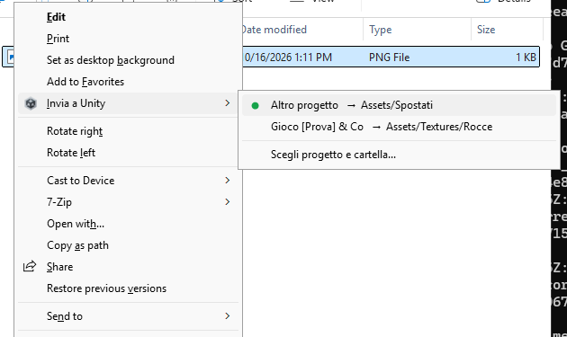
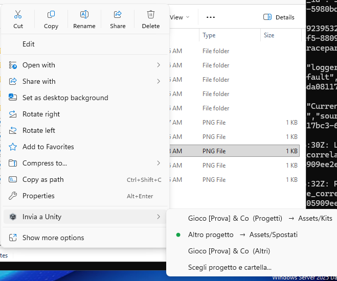
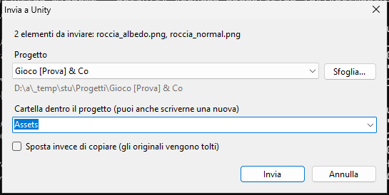
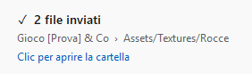
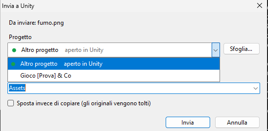
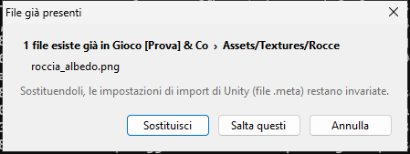

# Invia a Unity

Manda file e cartelle da Esplora risorse dentro un progetto Unity con il tasto destro:
niente trascinamenti, niente finestre affiancate.

Su Windows 11 la voce c'è anche nel menu ridotto, quello che si apre subito:

## Come si usa

Seleziona i file (o una cartella), tasto destro > **Invia a Unity** > clic sul progetto.

- **La prima volta** che usi un progetto si apre una finestra: scegli la cartella dentro
  `Assets` (puoi anche scriverne una nuova, viene creata).

  

- **Dalla seconda volta** il progetto compare nel menu con la sua cartella: un clic e i file
  sono dentro, senza finestre. Compare solo una notifica in basso a destra; cliccandola si apre
  la cartella con il file appena arrivato già selezionato (finché il mouse è sopra, la notifica
  non sparisce). Se la copia è lunga (cartelle grandi, file pesanti) la notifica mostra
  l'avanzamento.

  

- I progetti usati più di recente stanno in alto. Arrivano da Unity Hub e dai progetti recenti
  di Unity; se ne manca uno: **Scegli progetto e cartella...** > **Sfoglia...**
  Due progetti con lo stesso nome si distinguono dalla cartella che li contiene.
- Se il progetto è **aperto in Unity**, a copia finita Unity viene portato in primo piano e
  importa subito i file. Se è chiuso, li importa alla prossima apertura. I progetti aperti hanno
  un pallino verde, sia nel menu sia nella finestra di scelta: il menu viene preparato ogni volta
  che lo apri, quindi il pallino è sempre aggiornato.

  
- Se un file **esiste già** puoi sostituirlo o saltarlo. Sostituendo, il file `.meta` resta:
  riferimenti e impostazioni di import in Unity non si rompono. Premendo Invio si sostituisce.
  Se Unity sta ancora importando il vecchio file, il programma aspetta qualche secondo e riprova.

  

- Funziona con molti file insieme (provato con 40) e con le cartelle, sottocartelle comprese.
  Copiando una cartella vengono saltati `.git`, `__MACOSX`, `Thumbs.db` e simili.
- Nella finestra c'è anche **Sposta**, che toglie i file dalla posizione originale.
- **File `.meta` di Unity**, quando i file arrivano da un progetto Unity:
  - copiando, il `.meta` arriva insieme al file, quindi le impostazioni di import restano;
  - spostando, il `.meta` segue sempre il file (e le cartelle), quindi nell'origine non restano
    `.meta` orfani e, dentro lo stesso progetto, i riferimenti non si rompono;
  - copiando dentro lo stesso progetto il `.meta` non viene duplicato (Unity ne crea uno nuovo);
  - un `.meta` che il progetto di destinazione ha già non viene mai sostituito.
- Da tastiera: tasto menu (o Maiusc+F10), **I**, freccia destra, Invio.

## Installazione

1. Su GitHub: **Code** > **Download ZIP**, poi estrai lo zip.
2. Doppio clic su `install.cmd`.

Non servono download: il programma viene compilato sul tuo PC con il compilatore C# che fa già
parte di Windows. Se compare "Windows ha protetto il PC", clicca "Ulteriori informazioni" >
"Esegui comunque" (succede con i file .cmd scaricati da internet).

**Su Windows 11**, la prima volta, Windows chiede i permessi di amministratore: servono per far
comparire "Invia a Unity" anche nel menu ridotto (quello che si apre subito col tasto destro).
Se rispondi di no, la voce resta solo sotto "Mostra altre opzioni" e il resto funziona uguale.
Dalla seconda installazione in poi non lo chiede più.

Per aggiornare: rifai `install.cmd`. Per togliere tutto: `uninstall.cmd`.

## Da sapere

- Il menu del tasto destro è una piccola estensione di Esplora risorse (una DLL compilata da
  `install.cmd`, registrata solo per il tuo utente). Se dopo un aggiornamento il menu sembra
  ancora quello vecchio, esci da Windows e rientra (oppure riavvia Esplora risorse).
- La notifica segue il tema di Windows (chiaro o scuro), come i menu.
- **Windows 11, menu ridotto**: Windows mostra lì solo i programmi installati come pacchetto
  firmato. Il programma crea un pacchetto leggero (dentro ci sono solo la descrizione e un logo,
  i file restano in `%LOCALAPPDATA%\SendToUnity`) e lo firma con un certificato creato sul tuo PC.
  Il permesso di amministratore serve una volta sola, per aggiungere quel certificato a quelli
  di cui il PC si fida. La chiave segreta del certificato viene cancellata subito dopo la firma:
  nessuno può usarlo per firmare altro. Disinstallando, il pacchetto viene tolto ma il
  certificato resta tra quelli fidati (senza chiave non serve a nulla); se vuoi toglierlo:
  `certlm.msc` > Persone attendibili > Certificati > InviaAUnity > Elimina.
- Unity importa da solo solo se in *Preferences > Asset Pipeline* è attivo **Auto Refresh**
  e non sei in Play mode. Altrimenti premi Ctrl+R in Unity.
- C'è anche tasto destro > **Invia a** > **Progetto Unity**, che apre direttamente la finestra.
- Tutto quello che succede viene scritto in `%LOCALAPPDATA%\SendToUnity\log.txt`:
  se qualcosa non va, è il file da guardare (o da mandare).

## Per chi lo modifica

- `SendToUnity.cs` è tutto il programma. Deve restare compatibile con C# 5, perché lo compila
  il compilatore incluso in Windows. `install.cmd` lo compila due volte: come programma e come
  DLL del menu (`IExplorerCommand`), che Esplora risorse carica per mostrare le voci.
  Su Windows 11 lo stesso comando lo serve `SendToUnity.exe --menu-server`, registrato da un
  pacchetto con posizione esterna (sparse package) costruito e firmato con le API di Windows.
- `tests/test-windows.ps1` lo installa e lo prova su una vera macchina Windows (GitHub Actions,
  a ogni modifica di questa cartella): menu del tasto destro vero, finestre, copie, `.meta`,
  file bloccati, progetto aperto in un finto Unity, disinstallazione. Il runner gira da
  amministratore, quindi una parte del test crea un utente normale e rifà installazione, menu e
  invio come lui.
